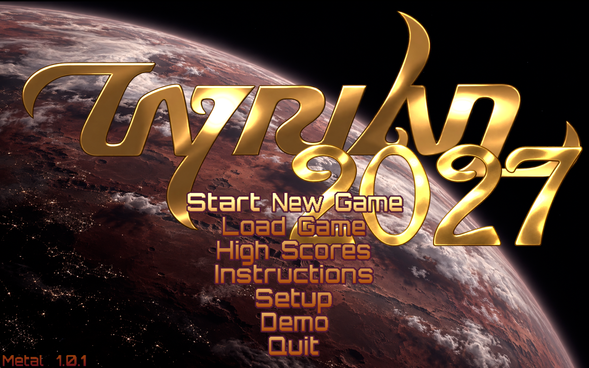
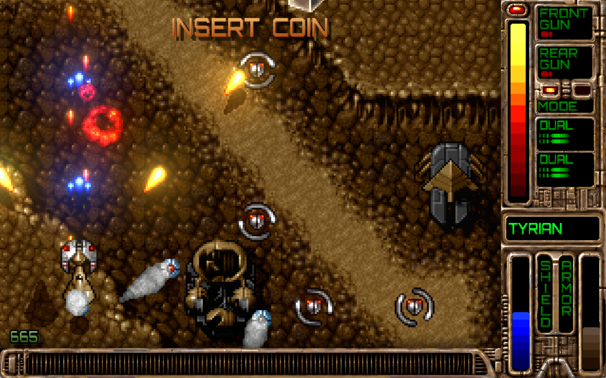

# MetalTyrian

An unofficial native Mac port of Tyrian 2000, the vertical-scrolling shooter
by Eclipse Software (1995, Tyrian 2000 in 1999). All five episodes, single
player, drawn with Metal, with Apple frameworks for input and sound. Not affiliated with the
original authors.



Version 1.0.1. Built on the game code of [OpenTyrian](https://github.com/opentyrian/opentyrian)
and [OpenTyrian2000](https://github.com/KScl/opentyrian2000).

## Download

Get the signed app from [Releases](https://github.com/johnrbeckett/metaltyrian/releases),
unzip it and drag MetalTyrian to Applications. It runs on macOS 13 Ventura or
later, on Macs with Apple Silicon. The Tyrian 2000 game data (freeware)
is inside the app; there is nothing else to install.

## What's new on the Mac

The full list, section by section, is in
[Documentation/CHANGES.md](Documentation/CHANGES.md).

- **Metal display:** sharp square pixels or an old VGA monitor's scanlines, HDR glow on shots and explosions, 4:3 or square aspect, black or ambient borders.
- **High-resolution art:** a new title screen and repainted menu, shop and HUD pictures, with the game's own pixels on top.
- **Crisp text:** Orbitron lettering in place of Tyrian's pixel font (or the original, if you prefer).
- **Edge smoothing:** smooth outlines on ships, shots and scenery, with the pixel art inside left crisp.
- **Dynamic light:** shots, engines and explosions light up what is near them.
- **Soft shadows:** the playfield sits inset in the HUD, and the score, lives and special float over it.
- **Sound:** the music on Nuked OPL3, effects in stereo where they happen on screen.
- **Controls:** one layout for either hand, with the keyboard, a mouse or trackpad (fly to where you point) or a gamepad; autofire; a controls panel at the start of a new game and when paused; superbombs on their own key.
- **Arcade ship picker:** fly any of the game's twelve ship looks in Arcade.

## Playing



One set of controls, for either hand. Every action is on the keyboard, so the
other hand can steer with the arrows (or W A S D), a mouse or a trackpad, and
switch between them at any moment. A panel shows the controls when a new game
starts (the first level waits until you press fire) and whenever the game is
paused.

| | Right-handed | Left-handed | Mouse or trackpad | Gamepad |
|---|---|---|---|---|
| Steer | Arrow keys | W A S D | Move | Left stick or D-pad |
| Fire | Space | Space | Click (left button) | A |
| Sidekicks (both) | Z | / | Right click (two-finger click) | LB, RB |
| Change rear weapon mode | X | . | Middle button | B |
| Superbomb, if you carry any | C | , | | Y |
| Autofire main guns on/off | 1 | 0 | | |
| Autofire sidekicks on/off | 2 | 9 | | |
| Pause | P | P | | Options |
| Game menu | Esc | Esc | | Menu |

These are the defaults: change any of them in Setup > Controls > Keys, where
each action has a key for either hand. Return also changes the rear weapon mode. Hold Command to free the mouse
pointer during play (for the menu bar). Left-handed mouse users can swap the
buttons in the Mac's System Settings > Mouse > Primary mouse button, and the
game follows. Autofire is also under Setup > Controls; with it on, weapons that
build up a charge fire at their lowest charge, so turn it off to charge them.
The special weapon (its icon top left, with a lamp that's green when it's
ready) fires with Fire. Quick specials, the ones ready again within about a
second (Pearl Wind, Ice Beam, Pulse Blast, Dual Vulcan and the like), keep
firing while Fire is held, and with autofire on they fire along with the guns.
Slow ones (Flare, MegaLaser, Missile Pod and the like) need a fresh tap of
Fire, so autofire never spends them by itself.

### Settings

In the game: **Setup > Graphics** (Display, Look, Glow, Aspect, Borders,
Text, Light, Edges), **Setup > Sound** (volumes, Stereo or Mono) and
**Setup > Controls** (keyboard, gamepad and mouse speed, mouse mode,
momentum, autofire).
The Mac menu bar mirrors them: **Graphics**, **Sound** and **Controls** menus
with the same settings, kept in step with the game. Shortcuts: Command-F full
screen (Control-Command-F and Fn-F work too), Command-1 Sharp, Command-2 Retro,
Command-G Glow, Command-T Crisp Text. Keys are changed in the game. Settings
are saved between launches.

## Building from source

Needs a Mac with Xcode 15 or later.

```
git clone https://github.com/johnrbeckett/metaltyrian.git
cd metaltyrian
scripts/build-app.sh
```

The app lands in `~/Library/Caches/MetalTyrian-build/MetalTyrian.app` (ad hoc
signed, for running on your own Mac). See
[Documentation/ARCHITECTURE.md](Documentation/ARCHITECTURE.md) for how the
pieces fit, [CONTRIBUTING.md](CONTRIBUTING.md) for working on it, and
[Documentation/CHANGES.md](Documentation/CHANGES.md) for everything that differs from
OpenTyrian, and [CHANGELOG.md](CHANGELOG.md) for what changed in each release.

## Repository layout

| Folder | Holds |
|---|---|
| `Sources/MetalTyrian/` | The Mac app in Swift: window, Metal renderer and shaders, input, audio, crisp text |
| `Sources/SDLShim/` | A small C stand-in for the parts of SDL 2 the game uses, and the interface the app talks to (`include/metaltyrian_host.h`) |
| `Engine/` | OpenTyrian2000's game code (C), with MetalTyrian's changes marked `#ifdef METALTYRIAN` |
| `App/` | Info.plist template, icon, fonts, high-resolution pictures and title art, bundled licences |
| `GameData/tyrian2000/` | The freeware Tyrian 2000 data files |
| `scripts/` | Build, release, credits, icon and picture preparation |
| `Tests/linux/` | A headless Linux host for checking the engine and shim without a Mac |
| `Documentation/` | Architecture, original plan, research and development notes |

## Credits

- MetalTyrian: John Beckett, built with Claude (Anthropic).
- Tyrian: Eclipse Software, published by Epic MegaGames in 1995. Released as freeware by Jason Emery in 2004: "Feel free to play it all you want and share it with friends."
- Tyrian 2000: Eclipse Software and XSIV Games, 1999. Freeware.
- Game code: OpenTyrian (github.com/opentyrian/opentyrian) and OpenTyrian2000 (github.com/KScl/opentyrian2000), in `Engine/`, under the GNU GPL version 2 or later. Includes hq2x, hq3x and hq4x by Maxim Stepin.
- Music chip emulation: Nuked OPL3 by Nuke.YKT (`Engine/src/opl3.c`), under the GNU LGPL 2.1 or later.
- Random numbers: Mersenne Twister by Makoto Matsumoto, Takuji Nishimura and Eric Landry (`Engine/src/mtrand.c`), under a BSD licence.
- Crisp text: Orbitron by Matt McInerney and the Orbitron Project Authors, under the SIL Open Font License 1.1.
- HUD smoothing: the Scale3x method by Andrea Mazzoleni.
- Art: title screen by John Beckett; menu, shop and HUD pictures redrawn at high resolution from the original Tyrian art, AI-assisted, prepared by John Beckett.

## Licence

MetalTyrian is free software under the GNU GPL version 2 or later, as
OpenTyrian (`LICENSE`). Each licence above is bundled in the app under
Contents/Resources/Licenses (`App/Licenses` here). The Tyrian 2000 data in
`GameData/` is freeware under the terms above. Tyrian is a trademark of its
owners; this project is unofficial.
